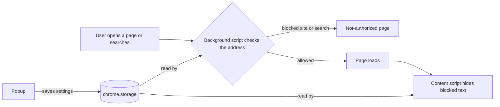

# SafeEyes 🛡️

SafeEyes is a browser extension that helps families control what they see online. You choose the categories you want to avoid (violence, adult content, romance, gambling...). SafeEyes then hides matching content, blocks related searches and websites, and keeps its settings behind a password so protection can't be switched off on impulse.

> Status: frontend demo. Accounts, categories and blocked domains live in the browser. There is no backend yet.

## Why I built it

Social media is full of violent, adult and offensive content and ads. Parents worry about what their children see, and many adults want to cut back but find it hard to stop. SafeEyes puts a password-protected filter between people and that content.

## Features

| Feature | What it does |
|---|---|
| Account | Register with a name and a password. Password rules are checked live as you type. |
| Categories | Pick what to block. Changes are saved when you press **Apply changes**. |
| Hides content | Posts, paragraphs and list items matching a blocked category disappear, including content a feed loads later. |
| Blocks searches and sites | Searching a blocked topic (Google, YouTube, Bing...) or opening a blocked site shows a "not authorized" page. |
| Think twice | Turning protection off asks "Do you really want to turn protection off?", then asks for the password. |
| Locked extensions page | Opening the browser's extensions page asks for the password first. |

  
  
  

## Install (Chrome, Edge, Brave)

1. Download or clone this repository.
2. Open `chrome://extensions` (or `edge://extensions`) and switch on **Developer mode**.
3. Click **Load unpacked** and choose the project folder.
4. Pin the SafeEyes icon and click it to create your account.

## How to use it

1. **Create an account** with a name and a password that meets the rules.
2. **Tick the categories** you want to block and press **Apply changes**.
3. Browse as usual. Matching content is hidden, and blocked searches or sites show the "not authorized" page.
4. To turn protection off, flip the switch, confirm, and enter your password.

## How it works

SafeEyes is plain JavaScript (Manifest V3) with no framework and no build step. It has four parts that share a few small modules.

| File | Responsibility |
|---|---|
| `manifest.json` | Declares the extension, its popup, scripts and permissions |
| `src/shared/categories.js` | Hard-coded categories with keywords and domains |
| `src/shared/storage.js` | The only file that touches `chrome.storage` (account, settings, temporary unlock) |
| `src/shared/filter.js` | Pure matching functions for text and domains |
| `src/popup/*` | Register, login and settings screens |
| `src/content/content.js` | Hides blocked content inside web pages |
| `src/background/background.js` | Watches navigation, blocks searches and sites, guards the extensions page |
| `src/blocked/*` | The "not authorized" page |
| `src/gate/*` | The password page shown before the extensions page |
| `test-pages/*` | A local page for trying the content hiding |

Design choices:

- **Shared logic lives in small modules** (`storage.js`, `filter.js`) used by the popup, the background script and the content script, so each rule exists in one place.
- **Only `storage.js` touches `chrome.storage`**, so changing where data is kept later means editing one file.
- **Pure functions for matching** keep the core logic easy to read and reason about.
- **User-controlled text is shown with `textContent`**, never `innerHTML`, so nothing from a URL can run as code.

## Accessibility and UX

- Every input has a visible label, and errors use `role="alert"` so screen readers announce them.
- Focus outlines are visible, and the whole popup works with the keyboard.
- Dialogs use the native `<dialog>` element, which traps focus and closes with Esc.
- The Apply button is disabled until there is something to apply, and the settings give clear feedback after saving.
- Status is never shown by colour alone (the password checklist also changes its symbol).

## Testing

SafeEyes is tested manually, step by step, using a local test page. **[TESTING.md](TESTING.md)** lists every component (registration, password rules, login, categories, protection switch, hiding content, blocked page, blocked searches and sites, extensions-page lock) with the steps to follow and the result to expect.

## Build log

This project was built in 10 steps, and the latest work is the current commit on `main`.

| Step | What was added | Commit message |
|---|---|---|
| 1 | Initial extension scaffold | `Add initial implementation of SafeEyes browser extension with README, icons, and popup` |
| 2 | Blocked content categories and popup category wiring | `Add blocked content categories and update popup to include categories script` |
| 3 | README refactor and storage layer | `Refactor README for clarity, enhance popup structure, and implement storage management for user settings` |
| 4 | User registration flow | `Implement user registration flow in popup with validation and styling` |
| 5 | Login flow and password verification | `Implement login functionality in popup with password verification and user feedback` |
| 6 | Category selection dashboard | `Enhance popup functionality: implement category selection dashboard with apply changes feature and update styles` |
| 7 | Password requirements checklist | `Enhance registration process: add password requirements checklist and validation feedback` |
| 8 | Password-protected disable flow | `Enhance popup functionality: implement protection toggle with confirmation and password verification` |
| 9 | Content filtering and blocked-page UI | `Add content filtering feature: implement page content blocking and blocked-page UI` |
| 10 | Background navigation tracking and extension-page protection | `Add background service worker for navigation tracking and enhance content filtering workflow` |

## Known limitations

These are deliberate shortcuts for a frontend demo.

- **Password storage.** The password is salted and hashed (SHA-256) in the browser. A real product would keep accounts on a server and hash with bcrypt or argon2.
- **Uninstall protection is a deterrent, not a lock.** A browser extension cannot intercept its own removal. The extensions page asks for the password, but right-clicking the toolbar icon and choosing "Remove" bypasses it. Real enforcement needs a managed browser policy that force-installs the extension.
- **Keyword matching is simple.** It can hide harmless text and miss harmful text, and it does not analyse images or video.
- **Changes apply on reload.** Open tabs need a refresh after settings change.
- **Chrome-based browsers only** (Chrome, Edge, Brave). Firefox would need small changes.

## Roadmap

- Backend API with parent accounts, and categories loaded from the server
- Text and image classification instead of plain keywords
- Separate profiles for each child, with an activity report for parents
- Full-page options screen and translations (including right-to-left languages)
- Firefox support

## Author

Built by **SafeEyes team** as a frontend demo. Feedback is welcome through issues.
